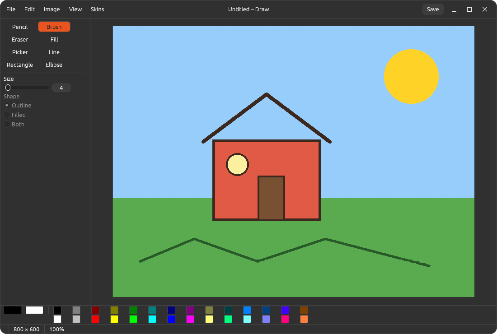

# Draw

The Unix MS Paint: a small bitmap paint program for sketching, annotating and quick fixes. A
[Patina](https://github.com/Sector-F-Labs/patina) (egui) app, so it takes Patina's skins and
follows the desktop's light/dark setting.



Pencil, brush, eraser, fill, colour picker, line, rectangle and ellipse; a palette with the
foreground colour on the left button and the background on the right; undo and redo; zoom; flip,
rotate, invert and canvas size; open and save PNG, JPEG, BMP, GIF (read) and WebP (read).
`draw picture.png` opens a file.

## Keys

| Key | |
|---|---|
| P B E F K L R O | Pencil, Brush, Eraser, Fill, Picker (K), Line, Rectangle, Ellipse (O) |
| X | Swap the foreground and background colours |
| Shift while dragging | Lines at 45° steps; squares and circles |
| Esc | Cancel the stroke in progress |
| Ctrl+N / O / S / Shift+S | New, Open, Save, Save As |
| Ctrl+Z / Ctrl+Shift+Z | Undo, Redo |
| Ctrl+C | Copy the picture to the clipboard |
| Ctrl+R / Ctrl+I | Rotate clockwise, invert colours |
| Ctrl+wheel, Ctrl+ +/− | Zoom; Ctrl+0 actual size, Ctrl+9 fit |

The right mouse button draws with the background colour and swaps a shape's outline and fill.
The Picker sets the foreground on the left button and the background on the right.

## Build

```bash
make            # list the targets
make run        # run it
make check      # tests + clippy -D warnings
make install    # per user, under ~/.local (PREFIX=... to change)
```

Settings are in `~/.config/draw/config.toml`; your own skins go in `~/.config/draw/skins/`.

## Not yet

Selections, text, layers, antialiasing and pasting an image in. See
[ADR-0002](docs/adr/0002-cpu-bitmap-and-snapshot-undo.md).

## Licence

BSD-3-Clause.
